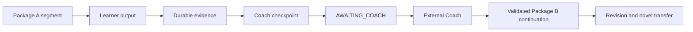

# Band8 Architecture

## Status

`v0.1.0-alpha.1` implements the local Runtime, evidence and artifact stores, Coach checkpoint exchange, reinforcement projections, and loopback Web Shell on top of the frozen B8TP 0.1 responsibility boundaries. It does not add an automatic Coach, cloud service, production deployment, or calibrated IELTS scoring.

## Responsibility split

| Concern | Owner | Durable output |
| --- | --- | --- |
| Diagnosis, hypotheses, personalized subjective feedback, strategy, content, package compilation | External Coach | Inference records and one package/continuation |
| Import, rendering, execution, objective scoring, state transitions, event capture | Band8 Runtime | Events, artifacts, checkpoints, results |
| Correct answers and deterministic scoring rules | Protected evaluation plane | Hash-bound non-renderable evaluation document |
| Reward eligibility | Reinforcement Engine | Versioned decision and qualification updates |
| Historical facts | Evidence Store | Immutable packages, events, artifact bytes/metadata, checkpoints, results, migrations |

Facts belong to Band8. Inferences and personalized pedagogical feedback belong to Coach. Runtime never calls a model to cross this boundary. Reward state never updates learning truth.

## Orchestration

One learner session may contain one run; one run may contain several immutable segments; each segment executes one package. A checkpoint ends a segment without pretending the whole run is complete.

## Runtime state machine

`CREATED → READY → RUNNING`. `RUNNING ↔ SUSPENDED`; `RUNNING → AWAITING_COACH`; a validated continuation advances `AWAITING_COACH → READY` for a new segment. Terminal paths are `COMPLETED` or `ABORTED`. Evidence-integrity failure enters `QUARANTINED` from any state.

## Local-first workspace

- `protocol/` is version-controlled authority.
- `packages/` and `protected/` store imported package and evaluation documents under Runtime-derived keys.
- `sessions/` stores session metadata, append-only events, checkpoints, and results under Runtime-derived keys.
- `artifacts/` stores learner artifact bytes and metadata under Runtime-derived keys.
- `coach/` stores explicit checkpoint exports and continuation bindings.
- `settings/` and `reinforcement/` store learning-timezone epochs and derived reinforcement state.
- Runtime storage roots own all paths; protocol paths are normalized relative paths.

## Runtime invariants

1. Import is deterministic and default-deny.
2. The alpha Runtime executes `INSTRUCTION`, `PRESENT_TEXT`, `SELECT`, and `TEXT_RESPONSE`; any other schema-valid V0.1 primitive is rejected explicitly as unsupported.
3. Ordinary text is DATA ONLY; no package field conveys code, host path, network, UI, tool, or reward authority.
4. Raw evidence is append-only and outranks all derived summaries.
5. Protected evaluation never projects into learner-visible content before its boundary.
6. Subjective feedback requires External Coach checkpoint continuation.
7. Reinforcement eligibility is independently computed by fixed Runtime policy.
8. Valid incomplete event prefixes are recoverable; corrupted raw evidence quarantines derived results.
9. Export remains available without a proprietary service.

## Phase boundary

B8TP 0.1 remains the protocol boundary. This alpha adds local product execution without changing that core protocol and still excludes model execution, cloud operation, and production deployment.
