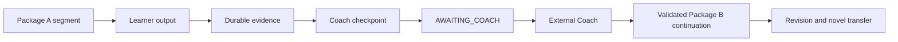

# Band8 Architecture

## Status

Phase 0.6 freezes protocol and responsibility boundaries only. No UI, backend, database, model integration, production Runtime, deployment, or Phase 1 implementation exists.

## Responsibility split

| Concern | Owner | Durable output |
| --- | --- | --- |
| Diagnosis, hypotheses, personalized subjective feedback, strategy, content, package compilation | External Coach | Inference records and one package/continuation |
| Import, rendering, execution, objective scoring, state transitions, event capture | Band8 Runtime | Events, artifacts, checkpoints, results |
| Correct answers and deterministic scoring rules | Protected evaluation plane | Hash-bound non-renderable evaluation document |
| Reward eligibility | Reinforcement Engine | Versioned decision and qualification updates |
| Historical facts | Evidence Store | Immutable packages, events, artifact bytes/metadata, checkpoints, results, migrations |

Facts belong to Band8. Inferences and personalized pedagogical feedback belong to Coach. Runtime never calls a model to cross this boundary. Reward state never updates learning truth.

## Orchestration

One learner session may contain one run; one run may contain several immutable segments; each segment executes one package. A checkpoint ends a segment without pretending the whole run is complete.

## Runtime state machine

`CREATED → READY → RUNNING`. `RUNNING ↔ SUSPENDED`; `RUNNING → AWAITING_COACH`; a validated continuation advances `AWAITING_COACH → READY` for a new segment. Terminal paths are `COMPLETED` or `ABORTED`. Evidence-integrity failure enters `QUARANTINED` from any state.

## Local-first workspace

- `protocol/` is version-controlled authority.
- `inbox/` receives untrusted packages and protected evaluation documents.
- `sessions/<session-id>/runs/<run-id>/segments/<segment-id>/` owns accepted package, events, checkpoint/result, and artifacts.
- `state/` contains learner state, hypotheses, review constraints, and reinforcement decisions.
- `export/` copies learner-owned protocol data without rewriting identifiers.
- Runtime storage roots own all paths; protocol paths are normalized relative paths.

## Runtime invariants

1. Import is deterministic and default-deny.
2. Only the ten V0.1 executable primitives run.
3. Ordinary text is DATA ONLY; no package field conveys code, host path, network, UI, tool, or reward authority.
4. Raw evidence is append-only and outranks all derived summaries.
5. Protected evaluation never projects into learner-visible content before its boundary.
6. Subjective feedback requires External Coach checkpoint continuation.
7. Reinforcement eligibility is independently computed by fixed Runtime policy.
8. Valid incomplete event prefixes are recoverable; corrupted raw evidence quarantines derived results.
9. Export remains available without a proprietary service.

## Phase boundary

Phase 0.6 produces contracts, schemas, examples, fixtures, and a deterministic reference validator. It does not implement persistence, UI isolation, model execution, or production recovery.
