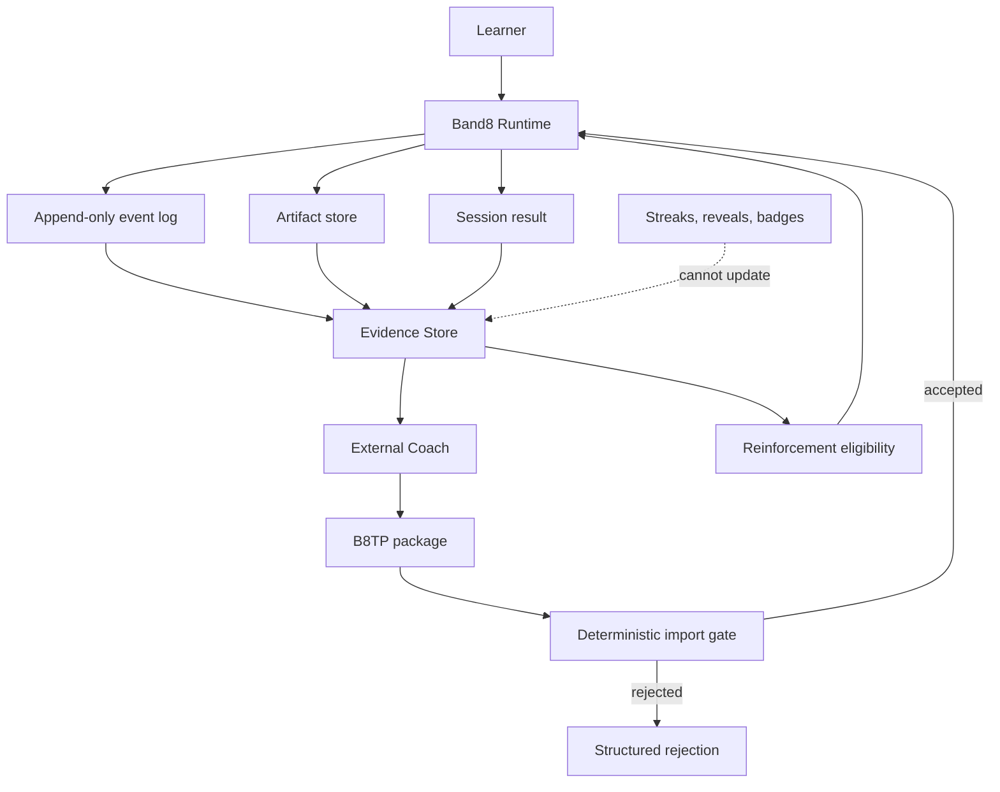

# Band8 Architecture

## Status

Phase 0 freezes protocol and responsibility boundaries only. No training UI, backend, model integration, database, or production runtime exists.

## Responsibility split

| Concern | Owner | Durable output |
| --- | --- | --- |
| Diagnosis, hypotheses, strategy, difficulty, content, session compilation | External Coach | Versioned B8TP training package and separately stored inference records |
| Import validation, rendering, execution, feedback timing, event capture | Band8 Runtime | Append-only events, artifacts, and session result |
| Behavioral reinforcement | Band8 Reinforcement Engine | Eligibility decision and presentation event |
| Historical facts | Evidence Store | Raw events, immutable artifacts, results, corrections, and migrations |
| Learning truth updates | Evidence-derived process | Traceable assessment observations; never reward state |

Facts belong to Band8. Inferences and training decisions belong to the Coach. Execution and reinforcement belong to Band8. A model cannot directly mutate raw evidence, accepted results, rewards, or runtime behavior.

## Logical components

## Local-first workspace

- `protocol/` is version-controlled authority.
- `inbox/` receives one untrusted package for import.
- `sessions/<session-id>/` contains the accepted package, append-only events, result, and artifacts.
- `state/` contains learner state, hypotheses, and review constraints.
- `export/` is a complete open-format copy of packages, facts, artifacts, and inferences.
- All stored paths are normalized relative paths using `/`; absolute paths and traversal are rejected.

## Runtime invariants

1. Import is deterministic and default-deny.
2. Only the V0.1 primitive whitelist is executable.
3. Package text cannot introduce HTML, JavaScript, shell, arbitrary URLs, or host file reads.
4. Raw evidence is append-only; correction uses a new record with `supersedes` or `invalidates`.
5. An aggregate result never replaces its source events.
6. Training, transfer, and assessment performance remain distinct.
7. Reinforcement state cannot update diagnosis, score, or assessment truth.
8. Export is available without a proprietary service.

## Phase boundary

Phase 0 produces contracts, schemas, examples, a deterministic fixture validator, and tests. It does not implement the Band8 Runtime or the External Coach.
